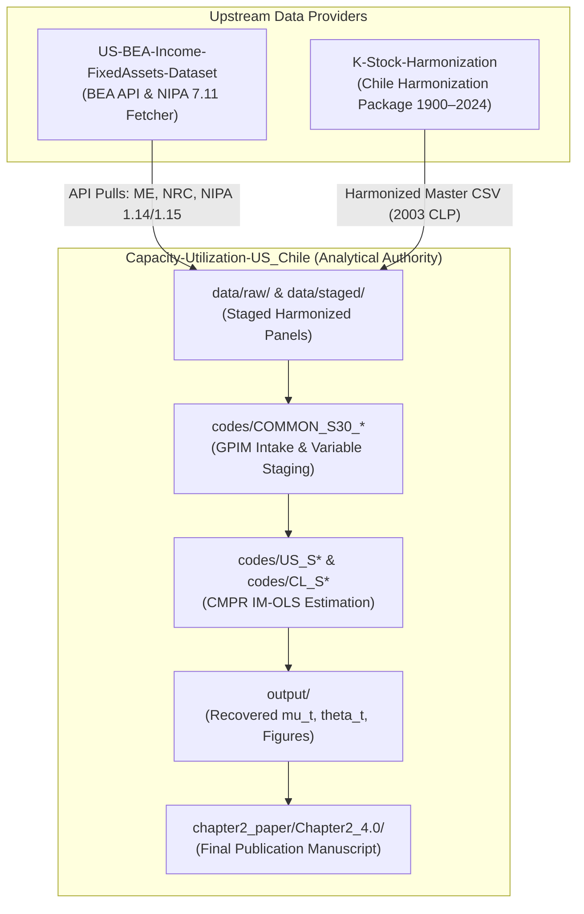

# Demand-Led Profitability and Structural Crisis of Capitalism in Chile and the United States during the Fordist Era

### Chapter 2: The Transformation of Accumulation into Productive Capacities — Capacity Utilization in the Center and Periphery

**Author:** Diego Polanco  
**Affiliation:** Doctoral Candidate, Department of Economics, University of Massachusetts Amherst  
**Contact:** `dpolanconeco@umass.edu`  
**Pipeline Status:** Production / Replication-Ready  
**Methodology:** Cointegrating Multivariate Polynomial Regression (CMPR) IM-OLS with Endogenous Structural Breaks & Fixed-$b$ Inference  

---

## 1. Overview & Theoretical Architecture

Standard macroeconomic treatments typically approach capacity utilization ($\mu_t \equiv Y_t / Y_t^p$) in one of three ways: as an exogenous steady-state benchmark, as a mechanical survey index, or as a statistical residual obtained by filtering output through univariate algorithms (e.g., Hodrick-Prescott). By imposing an aggregate transformation elasticity of unity ($\theta \equiv d\ln Y^p / d\ln K = 1$) by mathematical construction, these conventional approaches conflate effective utilization ($\mu_t$) with the long-run productive efficiency of the capital stock ($b_t \equiv Y_t^p / K_t$).

This chapter demonstrates that bivariate output--capital cointegration fails empirically. A stable long-run capacity frontier can only be identified once the capital relation is structurally mediated by distribution ($\omega_t$), asset composition ($\kappa_t \equiv k_t^{\text{ME}} - k_t^{\text{NRC}}$), and relative asset prices ($p_t^\kappa$). 

Capacity utilization is therefore **not a statistical residual left after trend filtering**; it is an object structurally reconstructed downstream of the identified transformation relation:

$$\omega_t \longrightarrow \theta_t \longrightarrow Y_t^p \longrightarrow \mu_t$$

```
   ┌────────────────────────────────────────────────────────┐
   │ 1. Upstream Capital & Income Ingestion                 │
   │    US: BEA Fixed Assets & NIPA Provider (API Fetch)    │
   │    CL: K-Stock-Harmonization Package (1900–2024)       │
   └───────────────────────────┬────────────────────────────┘
                               │
                               ▼
   ┌────────────────────────────────────────────────────────┐
   │ 2. Distributive Mediation & Cointegrating Estimation   │
   │    CMPR IM-OLS with Endogenous Bai-Perron Breaks       │
   │    US: Set 1 (Standard Wage) & Set 2 (Shaikh-Tonak)    │
   │    CL: Balance-of-Payments Threshold Mediation (Z_t)   │
   └───────────────────────────┬────────────────────────────┘
                               │
                               ▼
   ┌────────────────────────────────────────────────────────┐
   │ 3. Non-Standard Inference via Monte Carlo Simulation   │
   │    Specification-Dependent Fixed-b Critical Values     │
   │    Bartlett Kernel, Andrews Automatic Bandwidth (N=10⁵) │
   └───────────────────────────┬────────────────────────────┘
                               │
                               ▼
   ┌────────────────────────────────────────────────────────┐
   │ 4. Structural Recovery of Transformation Elasticity    │
   │    theta_t = theta_NRC + s_ME,t * MP_kappa,t            │
   │    US: theta in (0.37, 0.43) << 1                      │
   │    CL: Truncation under foreign-exchange bottleneck    │
   └───────────────────────────┬────────────────────────────┘
                               │
                               ▼
   ┌────────────────────────────────────────────────────────┐
   │ 5. Downstream Capacity & Utilization Recovery          │
   │    Y_t^p integrated from differential capacity law     │
   │    mu_t anchored strictly to historical Pinch Year     │
   │    (US: 1973 = 100%, CL: 1973 = 100%)                  │
   └────────────────────────────────────────────────────────┘
```

### Center vs. Periphery Comparative Mechanism
- **Center (United States, 1931–2024):** $\theta_t$ remains strictly below unity across the entire century, rising from $0.37$ in 1960 to $0.43$ in 2024 as distributive pressure eases and accumulation diverts into intellectual property and unproductive overhead. Capacity utilization declines steadily from its 1944 wartime peak to $93.8\%$ in 2024, never re-anchoring to its Fordist benchmark.
- **Periphery (Chile, 1940–2024):** A threshold balance-of-payments constraint ($\hat{\gamma} = 0.425$) fundamentally switches the mechanization response off. When foreign exchange binds, the wage-share elasticity of the capital composition gap collapses from $+3.29$ to $+0.14$. Peripheral capitalists retain the structural incentive to substitute machinery for labor, but lose the material ability to do so because capital goods are imported.

---

## 2. Upstream Data Ecosystem & Provider Repositories

The dissertation pipeline relies on two dedicated upstream provider repositories that fetch, stage, harmonize, and audit primary capital stock and national income accounts before they are ingested into `Capacity-Utilization-US_Chile`:



### 2.1. Provider 1: `US-BEA-Income-FixedAssets-Dataset`
- **Location:** `C:\ReposGitHub\US-BEA-Income-FixedAssets-Dataset`
- **Role:** Fetches, stages, documents, and validates source ingredients from the U.S. Bureau of Economic Analysis (BEA) API. It is an upstream *provider*, not the analytical authority.
- **API Setup:** Requires a registered BEA API key stored in the environment variable `BEA_API_KEY`.
- **Primary Routines:**
  - `codes/10_bea_api_helpers.R`: Core authenticated API client with rate-limiting, table discovery, and JSON-to-data-frame parsers.
  - `codes/20_fetch_fixed_assets_menu.R`: Fetches Fixed Assets Tables (FAA Tables 4.1, 4.2, 7.11) for Nonfinancial Corporate (`NFC`), Total Corporate (`CORP`), Financial Corporate (`FC`), and Total Private.
  - `codes/30_fetch_income_accounts_menu.R`: Ingests NIPA income tables (Tables 1.14, 1.15, 6.16) for Gross Value Added, Net Value Added, Compensation of Employees, and Net Operating Surplus.
  - `codes/40_stage_variable_menu_long.R`: Stages long-format raw panels under `data/staged/us_bea_variable_menu_long.csv`.
  - `codes/90_validate_variable_menu.R`: Validates the locked 71-variable menu and boundary integrity across all asset classes.
- **Provider Boundary:** The provider stages source ingredients. `Capacity-Utilization-US_Chile` owns downstream Generalised Perpetual Inventory Method (GPIM) calculations, Shaikh-Tonak income adjustments, wage share construction, and econometric models.

### 2.2. Provider 2: `K-Stock-Harmonization`
- **Location:** `C:\ReposGitHub\K-Stock-Harmonization`
- **Role:** Official reproduction package and source of truth for Chile's capital stocks (1900–2024), built according to AEA Data Editor Guidelines and FAIR principles.
- **Harmonization Architecture:**
  1. *Hofman Baseline (1900–1994):* Historical perpetual inventory estimates in constant 1980 CLP (`codes/run_baseline_hofman_1980.py`).
  2. *Pérez-Eyzaguirre Baseline (1900–1994):* Harmonized gross fixed capital formation (FBKF) in constant 2003 CLP (`codes/run_harmonization.py`).
  3. *Additive BCCh Extension Bundle (1900–2024):* Definitive extended surface incorporating modern Central Bank national accounts in constant 2003 CLP (`codes/run_harmonization_bcch.py`).
- **Master Reproduction Command:**
  ```bash
  cd C:\ReposGitHub\K-Stock-Harmonization
  python run_all.py
  ```
- **Definitive Master Dataset Consumed by Chapter 2:**
  `outputs/HARMONIZED_BCCH_2003CLP_v1/harmonized_master_dataset_2003CLP_1900_2024.csv`
- **Asset Classes Provided:**
  - Machinery & Equipment (`ME`)
  - Non-Residential Construction (`NRC`)
  - Residential Construction (`RC`)
  - Non-Residential Total (`NR = ME + NRC`)
  - Capital Deflators ($P_k$, base 2003 = 100) and implicit discard ($z$) and depreciation ($\delta$) rates.

---

## 3. Repository Architecture & Layout

```
Capacity-Utilization-US_Chile/
├── chapter2_paper/                     # Manuscript build layers
│   ├── Chapter2_4.0/                  # LATEST master manuscript (LaTeX sources, detrace logs, PDF)
│   ├── Chapter2_3.0/                  # Preserved v3.0 manuscript milestone
│   ├── WP_Chapter2_2.0/               # Working Paper v2.0 milestone
│   ├── WP_Chapter2_1.0/               # Working Paper v1.0 milestone
│   ├── paper_tex_3.0/                 # Draft fragments & stylized facts tables
│   └── paper_tex_tables/              # Extracted LaTeX table fragments
├── chapter2_vault/                    # Obsidian Research Vault & Governance Layer
│   ├── 00_constitutive_core/          # Foundational economic theory & closure definitions
│   ├── 02_analytical_foundation/      # Theoretical models (Shaikh, Okishio, Vidal)
│   ├── 03_econometrics/               # Integration order gates, estimator rules, MOC
│   ├── 04_data_measurement/          # Variable ledgers, provenance audits, K-stock intake
│   ├── 05_codes_implementation/       # Code-stage contracts and figure protocols
│   ├── 06_paper_facing/               # Locked section map, outline, and drafts
│   ├── 08_audits_handoffs/            # Session logs, parameter stability reports
│   └── 85_reports/                    # Internal analytical memos and diagnostic briefs
├── codes/                             # Flat, country/stage-prefixed executable pipeline
│   ├── CL_S*                          # Chile pipeline scripts (S05 to S92)
│   ├── US_S*                          # United States pipeline scripts (S29 to S62)
│   ├── COMMON_S*                      # Cross-country ingestion and routing utilities
│   └── generate_*.py                  # Automated publication table and matrix generators
├── data/                              # Data pipeline layers (strictly governed)
│   ├── raw/                           # Immutable primary source files (BEA, BCCh, ClioLab)
│   ├── interim/                       # Cleaned, spliced intermediate series
│   ├── processed/                     # Harmonized country panels & GDP deflators
│   ├── staged/                        # Model-ready CSV panels with price proxies
│   └── releases/                      # Frozen dataset candidate releases
├── output/                            # Quantitative artifacts ONLY (.csv, .png, .pdf figures)
│   ├── US/                            # US estimation results, MC critical values, figures
│   ├── CL/                            # Chile tiered results, threshold profiles, figures
│   └── artifact_routing/              # Audit routing matrices
├── reports/                           # Human-facing LaTeX manuscripts, memos, and report PDFs
│   ├── Chile_Section33_Peripheral_IMOLS_Results/
│   ├── US_Section31_IMOLS_Results/
│   ├── US_Section32_IMOLS_Results/
│   └── CHILE_solv_lev_ratio_plots/
└── scratch/                           # Local exploratory scripts (ignored by Git)
```

> [!IMPORTANT]
> **Directory Governance (Locked — Never Violate):**
> - **`output/`**: Strictly reserved for quantitative output artifacts—tables (`.csv`), figures (`.png`, `.pdf`), estimation ledgers, and raw data inputs. Never save LaTeX manuscript files (`.tex`) or compiled report PDFs directly into `output/`.
> - **`reports/`**: Store all written reports, executive summaries, LaTeX report source manuscripts (`.tex`), compiled report PDFs (`.pdf`), and analytical memos here.

---

## 4. Empirical Data Pipeline & Variables

The empirical framework harmonizes macroeconomic series across two distinct socio-technical regimes spanning 1920–2024.

| Variable | Description | US Source & Lineage | Chile Source & Lineage |
| :--- | :--- | :--- | :--- |
| **$Y_t$** | Real Output (GVA / NVA) | BEA NIPA Table 1.14 (Nonfinancial Corporate GVA & NVA) | BCCh spliced historical series / Pérez-Eyzaguirre (2003 CLP) |
| **$K_t^{\text{ME}}$** | Machinery & Equipment Capital | BEA Fixed Assets Table 4.1 / Table 4.2 (Net Stock) | ClioLab / Braun-Llona / K-Stock-Harmonization (2003 CLP) |
| **$K_t^{\text{NRC}}$** | Nonresidential Structures Capital | BEA Fixed Assets Table 4.1 / Table 4.2 (Net Stock) | ClioLab / Braun-Llona / K-Stock-Harmonization (2003 CLP) |
| **$K_{\text{cap}}$** | Productive Capital ($K^{\text{ME}} + K^{\text{NRC}}$) | Shaikh-Tonak capacity-producing capital boundary | Harmonized productive capital base (2003 CLP) |
| **$\omega_t$** | Wage Share / Exploitation | Standard NIPA compensation + Shaikh-Tonak net productive | Central Bank / Meller et al. / Díaz, Lüders & Sanhueza |
| **$\kappa_t$** | Capital Composition Ratio | $k_t^{\text{ME}} - k_t^{\text{NRC}}$ (log-difference) | $k_t^{\text{ME}} - k_t^{\text{NRC}}$ (log-difference) |
| **$p_t^\kappa$** | Relative Capital Asset Price | $P_t^{\text{ME}} / P_t^{\text{NRC}}$ (implicit deflators) | Real Exchange Rate & imported capital deflator proxies |
| **$Z_t$** | External Constraint Index | Excluded (Center currency issuer) | Composite balance-of-payments drainage & terms of trade |

---

## 5. Econometric Methodology

### 5.1. Estimator Hierarchy: CMPR IM-OLS
All empirical specifications are estimated using the **Cointegrating Multivariate Polynomial Regression (CMPR) Integrated Modified OLS (IM-OLS)** framework of Vogelsang and Wagner (2024), implemented via the custom extension of the `cointReg` engine:

$$y_t = \alpha + \theta_K k_t + \theta_{\omega\kappa} (\kappa_t \cdot \omega_t) + \theta_{\kappa p} (\kappa_t \cdot p_t^\kappa) + \boldsymbol{\gamma}' \mathbf{D}_t + u_t$$

Where $\mathbf{D}_t$ represents a vector of step dummies corresponding to endogenous structural breakpoints detected via the Bai-Perron (2003) algorithm.

### 5.2. Non-Standard Fixed-$b$ Inference
Standard asymptotic chi-squared and Gaussian inference severely over-rejects the null hypothesis in the presence of $I(1) \times I(1)$ interaction terms and step dummies. To obtain valid inferences:
1. **Specification-Dependent Monte Carlo Simulation:** We simulate the exact Data Generating Process (DGP) under $H_0: y_t^* \sim I(0)$ matching the integration geometry of the regressors.
2. **Fixed-$b$ Bandwidth:** Long-run variance estimation uses the Bartlett kernel with Andrews automatic bandwidth selection ($b = M/T$).
3. **Replication Scale:** Tail convergence is achieved via $N = 100,000$ iterations.
4. **Centered Hypothesis Testing:** Parameter critical values are simulated under centered DGPs ($t^* = |(\hat{\beta}^* - \beta) / \text{SE}(\hat{\beta}^*)|$) to avoid spurious power inflation.

---

## 6. End-to-End Replication Guide

### 6.1. System Prerequisites

#### R Environment (R $\ge$ 4.2)
Install the required CRAN packages:
```r
install.packages(c(
  "cointReg", "strucchange", "matrixStats", "parallel", 
  "sandwich", "urca", "tidyverse", "openpyxl", "readxl"
))
```

#### Python Environment (Python $\ge$ 3.10)
Set up a clean virtual environment and install dependencies:
```powershell
python -m venv .venv
.\.venv\Scripts\Activate.ps1
pip install pandas numpy openpyxl jinja2
```

#### LaTeX Environment
A full TeX Live or MiKTeX installation containing `pdflatex`, `biber`/`bibtex`, and the following packages:
`lmodern`, `geometry`, `setspace`, `microtype`, `graphicx`, `float`, `array`, `caption`, `subcaption`, `placeins`, `longtable`, `booktabs`, `threeparttable`, `siunitx`, `pdflscape`, `natbib`, `hyperref`, `cleveref`.

---

### 6.2. Pipeline Execution Sequence

Execute the flat pipeline sequentially from the repository root:

#### Phase 1: Data Preparation & Splicing
```powershell
# 1. Splice historical BCCh real GDP and GDP deflators (Chile)
python codes/CL_S05_query_and_splice_bcch_gdp.py
python codes/CL_S06_query_and_splice_bcch_deflator.py
python codes/00_build_gdp_deflator_dataset.py

# 2. Stage Shaikh-Tonak wage shares and capital intake (US)
Rscript codes/COMMON_S30_gpim_baseline_capital_intake.R
Rscript codes/US_S29F_shaikh_tonak_wage_share_construction.R
Rscript codes/COMMON_S30_stage_specB_variables.R

# 3. Stage Chile balance of payments and price proxies
Rscript codes/CL_S10_wbop_source_of_truth_panel.R
Rscript codes/CL_S40_price_proxy_integration.R
```

#### Phase 2: Econometric Estimation (IM-OLS)
```powershell
# 4. Estimate US Specification A (Physical Core)
Rscript codes/US_S50_section31_imols_estimation.R

# 5. Estimate US Specification B (Heterogeneous Capital & Price Channels)
Rscript codes/US_S61_section32_imols_specB.R

# 6. Estimate Chile Peripheral Threshold IM-OLS
Rscript codes/CL_S50_section33_imols_estimation.R
Rscript codes/CL_S54_imols_backward_expanding_windows.R
```

#### Phase 3: High-Performance Monte Carlo Simulations ($N=100,000$)
> [!NOTE]
> *Parallel processing runs across all available CPU cores. Runtime: ~15–25 minutes per script.*
```powershell
# 7. Simulate custom fixed-b critical values for US Spec A & Spec B
Rscript codes/US_S52_section31_cmpr_montecarlo_critical_values.R
Rscript codes/US_S62_section32_imols_montecarlo.R

# 8. Simulate custom critical values for Chile Threshold CMPR
Rscript codes/CL_S52_cmpr_montecarlo_critical_values.R
```

#### Phase 4: Structural Capacity Recovery & Master Figure Generation
```powershell
# 9. Recover transformation elasticities (theta_t) and capacity utilization (mu_t)
Rscript codes/US_S60_section432_aggregate_elasticity.R
Rscript codes/US_S60_capacity_utilization_recovery.R
Rscript codes/CL_S60_capacity_utilization_recovery.R

# 10. Generate publication-ready figures (.pdf and .png)
Rscript codes/US_S60_generate_master_figures.R
Rscript codes/CL_S60_generate_chile_master_figures.R
Rscript codes/CL_S90_solv_lev_ratio_plots.R
Rscript codes/CL_S91_wbop_structural_ratio_plots.R
Rscript codes/S60_section5_comparative_mu.R
```

#### Phase 5: Publication Table Compilation
```powershell
# 11. Generate automated LaTeX tables formatted with custom MC significance stars
python codes/generate_s31_latex_tables.py
python codes/generate_s32_latex_tables.py
python codes/export_specB_paper_tables.py
python codes/generate_appendixD_mc_bounds_table.py
```

---

## 7. Compiling the Chapter Manuscript

The definitive master source of the dissertation chapter lives in:
📂 **`chapter2_paper/Chapter2_4.0/`**

### Manuscript Structure
- `main.tex` — Master LaTeX driver document
- `section1.tex` — The Unresolved Problem: Why Utilization Cannot Be a Residual
- `section2.tex` — The Structural Reconstruction Across Levels (Shaikh, Okishio, Vidal)
- `section3.tex` — The Hinge Object: $\theta_t$ Identification and Distributive Conditioning
- `section4.tex` — Empirical Reconstruction: United States & Chile
- `section5.tex` — Center--Periphery Comparative Determination
- `section6.tex` — Concluding Remarks & Chapter 3 Transmission
- `appendixA.tex`–`appendixF.tex` — Data provenance, integration order gates, and critical value matrices

### To Compile via LaTeXmk:
```powershell
cd chapter2_paper/Chapter2_4.0
latexmk -pdf -synctex=1 main.tex
```

The resulting compiled paper will output directly to `Chapter2_4.0/main.pdf`.

---

## 8. Locked Symbology & Mathematical Notation

All prose, tables, models, and code strictly follow the immutable notation lock codified in `00S_Chapter2_Symbology_and_Notation_Lock.md`:

| Symbol | Mathematical Definition | Strict Lexical Rule |
| :--- | :--- | :--- |
| $\mu_t$ | Capacity Utilization ($Y_t / Y_t^p$) | Never write "$u$" |
| $\chi_t$ | Recapitalization Rate ($I_t / \Pi_t$) | Never write "$\beta_t$" |
| $q$ | Mechanization Growth Rate | Never write "$m$" ($m$ reserved for import share) |
| $\kappa_t$ | Capital Composition Ratio ($k_t^{\text{ME}} - k_t^{\text{NRC}}$) | Replaces historical $\tau_t$ |
| $\theta_j$ | Aggregate transformation parameters | $g_{Y^p} = \theta g_K$ and $dY^p / dK = \theta$ |
| $p_t^i$ | Relative price variable ($p_t^\kappa = P_t^{\text{ME}} / P_t^{\text{NRC}}$) | Excluded from Spec A; enters Spec B |
| $\boldsymbol{\gamma}, \boldsymbol{\Gamma}$ | Step dummy vectors in single/system models | Reserved for structural break controls |
| $\delta$ | Economic depreciation rate of net capital | Never use for step dummies |
| $z$ | Discard / depletion rate of gross capital | Distinct from net depreciation $\delta$ |
| **MPF** | Mechanization Productive Frontier | Never "Maximum Productive Frontier" or "IPF" |

---

## 9. Citation & Attribution

If you utilize this codebase, empirical panels, or econometric estimation framework, please cite:

```bibtex
@phdthesis{polanco2026demand,
  author       = {Diego Polanco},
  title        = {Demand-Led Profitability and Structural Crisis of Capitalism in Chile and the United States during the Fordist Era},
  school       = {Department of Economics, University of Massachusetts Amherst},
  year         = {2026},
  type         = {Doctoral Dissertation},
  note         = {Chapter 2: The Transformation of Accumulation into Productive Capacities: Capacity Utilization in the Center and Periphery}
}
```

---

## 10. License & Replication Guarantee

This repository is maintained for forensic replication under the **MIT License**. All econometric pipelines, staged datasets, Monte Carlo routines, and figure scripts are self-contained and reproducible.
