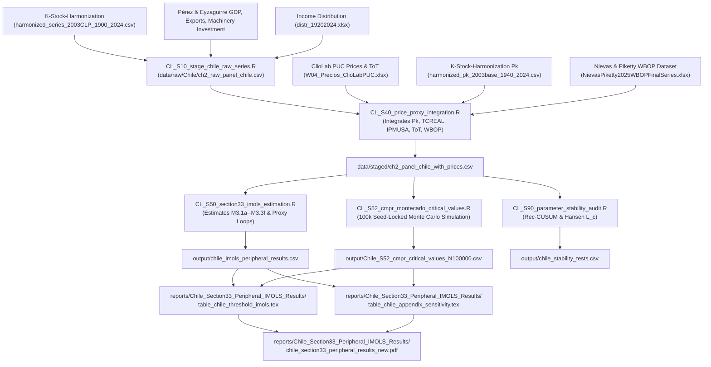

# Chile Capital Stock, WBOP Series & Peripheral Data Provenance Management

> [!important] Identification, Level Anchoring & Seed Locks
> Downstream Chilean estimations (Section 3.3 / 4.4 Peripheral CMPR IM-OLS) must follow [[00S_Chapter2_Symbology_and_Notation_Lock]] and [[D03_capacity_utilization_level_anchor_pinch_year_protocol]]:
> - **Real Net Output**: $y_t = \ln Y_t$ (Log Aggregate Chilean Real GDP in 2003 CLP)
> - **Extensive Structures Stock**: $k^{\text{NR}}_t = \ln K^{\text{NR}}_t$
> - **Intensive Machinery Stock**: $k^{\text{ME}}_t = \ln K^{\text{ME}}_t$
> - **Mechanization Gap**: $\kappa_t = k^{\text{ME}}_t - k^{\text{NR}}_t$
> - **Prebischian Capacity to Import**: $M^{\text{cap, ToT}}_t = \text{ToT}_t \cdot X_{\text{FOB}, t}$ (Purchasing power of exports)
> - **Demand/Supply Imbalance Term**: $\text{Imbalance}_t = \ln(I_{\text{ME}, t}) - \ln(M^{\text{cap, ToT}}_t)$ (Machinery investment demand vs import capacity)
> - **Multi-Proxy Relative Capital Prices ($p^{\kappa}_t$)**:
>   - $p^{\kappa}_{\text{rer}} = \ln(\text{TCREAL}_{\text{rebased}})$
>   - $p^{\kappa}_{\text{ipmusa}} = \ln(\text{IPMUSA}_{\text{rebased}} / P_{K, \text{rebased}})$
>   - $p^{\kappa}_{\text{composite}} = \ln((\text{IPMUSA}_{\text{rebased}} \cdot \text{TCREAL}_{\text{rebased}}) / P_{K, \text{rebased}})$
>   - $p^{\kappa}_{\text{tot\_adj}} = \ln((\text{IPMUSA}_{\text{rebased}} / \text{TERMINT}_{\text{rebased}}) / P_{K, \text{rebased}})$
> - **Level Anchoring**: $t^*_{\text{CL}} = 1980 / 1981$ (Ffrench-Davis pre-1982 crisis peak, $\mu_{\text{CL}, 1980} = 1.0$)
> - **Random Seed Lock**: `set.seed(1920)` / `clusterSetRNGStream(cl, 1920)` for exact 100k Monte Carlo replication.

---

## 1. Purpose & Repository Handoff Architecture

This document formalizes the data provenance, upstream handoff boundaries, and variable lineage between the upstream provider repository:

```text
C:\ReposGitHub\K-Stock-Harmonization
```

and the primary analytical research repository:

```text
C:\ReposGitHub\Capacity-Utilization-US_Chile
```

### Upstream Ownership (`K-Stock-Harmonization`)
- Owns physical capital stock harmonization (`HARMONIZED_BCCH_2003CLP_v1`).
- Splicing of legacy historical series (Perez 1996 / Hofman 1900–1994) with Central Bank of Chile (BCCh 1995–2024) national accounts in constant 2003 CLP.
- Construction and validation of the capital stock deflator $P_K$ (1940–2024, 2003=100).

### Downstream Ownership (`Capacity-Utilization-US_Chile`)
- Staging of distribution data ($\omega_t$ profit/wage shares from `distr_19202024.xlsx`).
- Staging of Real GDP ($Y_t$), exports ($X^{\text{FOB}}$), imports ($M^{\text{CIF}}$), and machinery investment ($I_{\text{ME}}$) from `PerezEyzaguirre_DemandaAgregada.xlsx`.
- Staging of price and trade series from ClioLab PUC (`W04_Precios_ClioLabPUC.xlsx`): Real Exchange Rate `TCREAL` (Sheet 4.2.2), US Wholesale Index `IPMUSA` (Sheet 4.3.6), and Terms of Trade `TERMINT` (Sheet 4.3.2).
- Staging of Nievas & Piketty (2025) World Balance of Payments (`WBOP`) series from `NievasPiketty2025WBOPFinalSeries.xlsx` (Column `CL`): Manufactured imports (`B3c`), net manufactured trade (`B3a`), foreign income outflows / profit remittance drain (`D1c`), and current account balance (`F1`).
- Construction of mechanization gaps ($\kappa_t$), FWL-orthogonalized interactions ($\omega_{t-1} \cdot \kappa_t$), multi-proxy relative price ratios ($p^{\kappa}_t$), and threshold indicators ($D^{\text{ext}}_t$).
- Estimation of Section 3.3 CMPR IM-OLS equations, seed-locked 100k Monte Carlo critical value generation (`CL_S52`), and capacity utilization reconstruction ($\mu_t$).

---

## 2. Upstream Source Data Provenance Matrix

| Variable Symbol | Description & Unit | Primary Source Provenance | Upstream Repo Path / File | Time Span | Status |
| :--- | :--- | :--- | :--- | :--- | :--- |
| $K^{\text{NR}}_t$ | Non-Residential Structures Real Net Capital (2003 CLP) | Perez (1996) / Hofman (1900–1994) + BCCh (1995–2024) | `K-Stock-Harmonization/outputs/HARMONIZED_BCCH_2003CLP_v1/harmonized_series_2003CLP_1900_2024.csv` | 1900–2024 | Locked Source of Truth |
| $K^{\text{ME}}_t$ | Machinery & Equipment Real Net Capital (2003 CLP) | Perez (1996) / Hofman (1900–1994) + BCCh (1995–2024) | `K-Stock-Harmonization/outputs/HARMONIZED_BCCH_2003CLP_v1/harmonized_series_2003CLP_1900_2024.csv` | 1900–2024 | Locked Source of Truth |
| $P_K$ | Capital Formation Price Deflator (2003=100) | BCCh `FBKF_nom / FBKF_real` (1960–2024) + ClioLab backcast (1940–1959) | `K-Stock-Harmonization/outputs/HARMONIZED_BCCH_2003CLP_v1/harmonized_pk_2003base_1940_2024.csv` | 1940–2024 | Locked Price Deflator |
| $Y_t$ | Aggregate Real GDP (2003 CLP) | Pérez & Eyzaguirre aggregate demand dataset | `data/raw/Chile/PerezEyzaguirre_DemandaAgregada.xlsx` | 1860–2024 | Raw Input |
| $I_{\text{ME}, t}$ | Gross Machinery Investment (2003 CLP) | Pérez & Eyzaguirre (`FBKF en maquinaria`) | `data/raw/Chile/PerezEyzaguirre_DemandaAgregada.xlsx` | 1860–2024 | Demand Imbalance Input |
| $\omega_t$ | Distribution Wage Share ($1 - \Pi_t / Y_t$) | Functional income distribution panel | `data/raw/Chile/distr_19202024/distr_19202024.xlsx` | 1920–2024 | Raw Input |
| $X^{\text{FOB}}_t$ | Exports FOB Volume (2003 CLP) | Pérez & Eyzaguirre aggregate demand dataset | `data/raw/Chile/PerezEyzaguirre_DemandaAgregada.xlsx` | 1860–2024 | Export Supply Input |
| $\text{TCREAL}$ | Real Exchange Rate Index | ClioLab PUC Sheet 4.2.2 | `data/raw/Chile/W04_Precios_ClioLabPUC.xlsx` | 1900–2024 | Price Proxy Input |
| $\text{IPMUSA}$ | US Wholesale Capital Price Index | ClioLab PUC Sheet 4.3.6 | `data/raw/Chile/W04_Precios_ClioLabPUC.xlsx` | 1900–2024 | Price Proxy Input |
| $\text{TERMINT}$ | Terms of Trade Index | ClioLab PUC Sheet 4.3.2 | `data/raw/Chile/W04_Precios_ClioLabPUC.xlsx` | 1810–2024 | ToT Capacity Input |
| $M^{\text{manuf}}_t / Y_t$ | Manufactured Goods Imports (% GDP) | Nievas & Piketty (2025) WBOP Sheet `B3c` (Col `CL`) | `data/raw/Chile/WBOP/NievasPiketty2025WBOPFinalSeries.xlsx` | 1800–2024 | WBOP Capital Import Proxy |
| $D1c_t$ | Foreign Income Outflows (% GDP) | Nievas & Piketty (2025) WBOP Sheet `D1c` (Col `CL`) | `data/raw/Chile/WBOP/NievasPiketty2025WBOPFinalSeries.xlsx` | 1800–2024 | Profit Remittance Drain |
| $F1_t$ | Net Current Account Balance (% GDP) | Nievas & Piketty (2025) WBOP Sheet `F1` (Col `CL`) | `data/raw/Chile/WBOP/NievasPiketty2025WBOPFinalSeries.xlsx` | 1800–2024 | External Balance Proxy |

---

## 3. Downstream Processing & Script Pipeline



---

## 4. Key Cross-Repository Data Contracts & Bridge Validation

1. **2003 CLP Base Year Parity**: 
   All real production series ($Y_t$), machinery capital ($K^{\text{ME}}_t$), structures capital ($K^{\text{NR}}_t$), machinery investment ($I_{\text{ME}, t}$), and exports ($X^{\text{FOB}}_t$) are locked to **2003 CLP**.

2. **1994 Bridge Factor Alignment**:
   `K-Stock-Harmonization` applies exact 1994 multiplicative bridge factors when extending legacy history (1900–1994) with official BCCh series (1995–2024):
   - $\text{ME Bridge Factor (1994)} = 5.888124411554$
   - $\text{NR Bridge Factor (1994)} = 1.033303538667$
   - $\text{RC Bridge Factor (1994)} = 1.049933189026$

3. **Multi-Proxy Relative Price Deflator Formulas**:
   - $p^{\kappa}_{\text{rer}} = \ln(\text{TCREAL}_{\text{rebased}})$
   - $p^{\kappa}_{\text{ipmusa}} = \ln(\text{IPMUSA}_{\text{rebased}} / P_{K, \text{rebased}})$
   - $p^{\kappa}_{\text{composite}} = \ln((\text{IPMUSA}_{\text{rebased}} \cdot \text{TCREAL}_{\text{rebased}}) / P_{K, \text{rebased}})$
   - $p^{\kappa}_{\text{tot\_adj}} = \ln((\text{IPMUSA}_{\text{rebased}} / \text{TERMINT}_{\text{rebased}}) / P_{K, \text{rebased}})$

4. **100k Monte Carlo Seed Lock**:
   Simulation sampling distributions are generated with random seed fixed at `1920` (`set.seed(1920)` / `clusterSetRNGStream(cl, 1920)`), yielding the following 100k bounds ($N=100,000$):
   - $CT_{\text{IM}}$ (Cointegration Test): $90\% = 0.0329, 95\% = 0.0430, 99\% = 0.0682$.
   - Threshold interaction penalty ($t$-statistic bounds): $90\% = 2.585, 95\% = 3.697, 99\% = 8.736$.

---

## 5. Related Vault Notes

- [[00N_Chapter2_PaperFacing_MAP]] — Locked 6-section paper structure
- [[00E_Chapter2_PaperFacing_Constitution]] — Constitutional paper-facing claim
- [[00S_Chapter2_Symbology_and_Notation_Lock]] — Master notation lock
- [[D03_capacity_utilization_level_anchor_pinch_year_protocol]] — Pinch-year level anchor protocol
- [[2026-08-07_data_provenance_audit_report]] — US master data provenance audit report
- [[2026-08-09_chile_data_provenance_audit_report]] — Chile master data provenance audit report
- [[ch2_sec4_4_1_specifications]] — Chile peripheral extension model specifications draft
