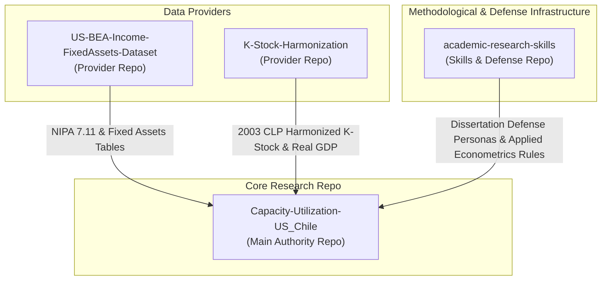
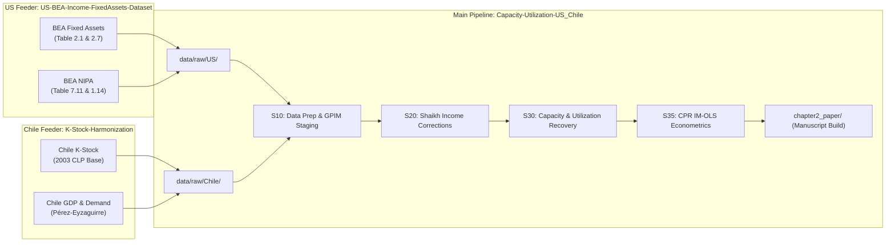

# Repository Reorganization & Multi-Repo Architecture Handoff

This document details the completed repository reorganization, the active directory layout, the data provenance architecture, and the multi-repository network powering Chapter 2 of the dissertation: *"Demand-Led Profitability and Structural Crisis of Capitalism in Chile and the United States during the Fordist Era."*

---

## 1. Summary of Completed Reorganization Work

1. **Definitive Outline Partition (Chapter 2 / Chapter 3 Bounding):**
   * Pruned [`Ch2_Outline_DEFINITIVE.md`](file:///c:/ReposGitHub/Capacity-Utilization-US_Chile/chapter2_vault/06_paper_facing/Ch2_Outline_DEFINITIVE.md) to restrict Chapter 2 strictly to the capacity-to-profitability corridor ($\tilde{k}_t \rightarrow \tilde{y}_t^p \rightarrow \mu_t \rightarrow \pi_t$).
   * Removed Subsection 2.3.3 (Recapitalization Corridor), Section 4/5 investment function estimations ($\chi_t, \psi_j$), and Subsections 6.1.2/6.1.3 (Chile/Comparative investment corridors).
   * Refocused Section 7 to frame the recapitalization corridor as the structural bridge to Chapter 3.

2. **Repository Layout Cleanliness & Flattening:**
   * Enforced strict stage-gate layout for [`codes/`](file:///c:/ReposGitHub/Capacity-Utilization-US_Chile/codes/). Top-level subdirectories are restricted to `codes/legacy/` and `codes/runs/`.
   * Purged LaTeX build junk (`.aux`, `.log`, `.nav`, `.snm`, `.toc`, `.fls`, `.fdb_latexmk`) across all directories.
   * Created `_legacy/` within [`chapter2_vault/03_econometrics/`](file:///c:/ReposGitHub/Capacity-Utilization-US_Chile/chapter2_vault/03_econometrics/) to isolate superseded D12V DOLS/FM-OLS notes, keeping only 14 active CPR IM-OLS files in the open vault root.

3. **YAML Metadata Standardization:**
   * Standardized Obsidian-compatible 6-property YAML frontmatter (`type`, `status`, `depends_on`, `stage_scope`, `country`, `last_updated`) across **159 markdown files** in `chapter2_vault/` and `reports/`.

4. **Feeder Data Provenance:**
   * Created [`data/metadata/data_provenance_manifest.md`](file:///c:/ReposGitHub/Capacity-Utilization-US_Chile/data/metadata/data_provenance_manifest.md) mapping input streams from feeder repositories (`US-BEA-Income-FixedAssets-Dataset` and `K-Stock-Harmonization`) into `data/raw/` and `data/staged/`.

5. **Automated Verification:**
   * Created dual automated test scripts in [`tests/verify_repo_tidy.py`](file:///c:/ReposGitHub/Capacity-Utilization-US_Chile/tests/verify_repo_tidy.py) and [`tests/verify_repo_tidy.R`](file:///c:/ReposGitHub/Capacity-Utilization-US_Chile/tests/verify_repo_tidy.R) that programmatically confirm 0 layout violations and 100% YAML compliance.

---

## 2. Multi-Repository System Architecture

The dissertation pipeline operates across four interconnected Git repositories:



### Roles and Boundaries:

| Repository | Role | Key Responsibilities & Artifacts |
| :--- | :--- | :--- |
| **`Capacity-Utilization-US_Chile`** | **Main Authority & Analytical Engine** | Owns paper drafts (`chapter2_paper/`), active vault (`chapter2_vault/`), GPIM capital stock refreezing, Shaikh income corrections, utilization recovery ($\mu_t$), CPR IM-OLS econometric estimations, and comparative US/Chile synthesis. |
| **`US-BEA-Income-FixedAssets-Dataset`** | **US Raw Data Provider** | Fetches, stages, documents, and validates BEA Fixed Assets and NIPA source variables (Table 7.11 corporate/NFC income lines, $K^{ME}$, $K^{NRC}$). Does **not** construct final adjusted value added or capacity utilization. |
| **`K-Stock-Harmonization`** | **Chile Raw Data Provider** | Fetches, stages, deflates (2003 CLP base), and harmonizes Chile capital stock series ($K^{NR}, K^{ME}$) and aggregated demand/GDP components. |
| **`academic-research-skills`** | **Methodological & Evaluation Suite** | Provides dissertation committee simulation (`PE-phd-committee`: Michael Ash, Deepankar Basu, Kevin Young), applied econometrics guidelines (`umass-applied-econometrics`), and paper writing/review pipelines (`academic-paper`, `advisor-reviewer`). |

---

## 3. Data Pipeline & Data Provenance Map



---

## 4. Active Directory Map of `Capacity-Utilization-US_Chile`

```
Capacity-Utilization-US_Chile/
├── chapter2_paper/            # Paper source files, LaTeX templates, and Obsidian writing vault
│   └── 01_Versions/           # Markdown chapter builds (Ch2_Draft_Definitive.md)
├── chapter2_vault/            # Active Obsidian governance vault
│   ├── 00_constitution/       # Core constitutional claims & paper-facing maps
│   ├── 03_econometrics/       # Active econometric protocol (IM-OLS CPR lock)
│   │   └── _legacy/           # Archived D12V DOLS/FM-OLS notes (22 files)
│   ├── 05_codes_implementation/ # Stage governance rules (C03-REPO_STRUCTURE.md)
│   ├── 06_paper_facing/       # Locked outline (Ch2_Outline_DEFINITIVE.md), reviews, handoffs
│   ├── 07_WrittingSkills_and_Rules/ # Advisor exposition rules & WLM v4.0 prose style
│   └── 80_Prompts/            # Execution prompts and plans
├── codes/                     # Flat execution scripts directory
│   ├── legacy/                # Retired historical scripts
│   └── runs/                  # Execution subdirectories (S34R, S35, etc.)
├── data/                      # Data pipeline layers
│   ├── raw/                   # Raw inputs from BEA and Chile feeder repos
│   ├── interim/               # Intermediate staged data
│   ├── processed/             # Final processed time series
│   ├── metadata/              # Provenance manifest (data_provenance_manifest.md)
│   └── releases/              # Frozen data releases
├── output/                    # Country- and stage-bounded empirical results
│   ├── US/                    # US empirical outputs (S10-S90)
│   └── CL/                    # Chile empirical outputs
└── tests/                     # Verification test scripts (verify_repo_tidy.py / .R)
```

---

## 5. Active Econometric Doctrine Handoff

* **Active Lock:** [`E10V_IMOLS_CPR_Active_Estimator_Lock.md`](file:///c:/ReposGitHub/Capacity-Utilization-US_Chile/chapter2_vault/03_econometrics/E10V_IMOLS_CPR_Active_Estimator_Lock.md)
* **Preferred Estimator:** **IM-OLS (adapted for Cointegrating Polynomial Regressions - CPR)** using the Vogelsang-Wagner partial sum transformation.
* **Mandatory Pre-Filter:** **Orthogonalization (Residual Centering)** of interaction terms to eliminate collinearity between linear regressors ($\tilde{k}_t, \omega_t$) and the $I(2)$ interaction term ($\tilde{k}_t \cdot \omega_{t-1}$).
* **Blocked Estimators:** DOLS (blocked due to dynamic regressor explosion) and standard FM-OLS (blocked due to $I(2)$ long-run covariance kernel/bandwidth instability).
* **Next Empirical Step:** Execute `US_S35_estimator_refreeze_cpr.R` and Chile equivalent scripts under the new E10V lock to populate final paper tables for Sections 5.1 and 5.2.
