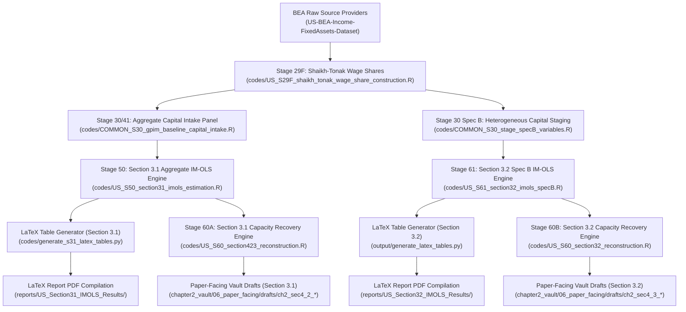

# Master Data Provenance & Cross-Referenced Source-of-Truth Audit Report

**Date:** 2026-08-07  
**Scope:** U.S. Non-Financial Corporate (NFC) Empirical Pipeline (1929–2024, $T=94$)  
**Authority:** `chapter2_vault/06_paper_facing/00N_Chapter2_PaperFacing_MAP.md` & `00E_Chapter2_PaperFacing_Constitution.md`

---

## Executive Summary

This audit report establishes the complete end-to-end data provenance and cross-referenced source-of-truth mapping for the Chapter 2 quantitative research pipeline. It connects all upstream provider datasets, transformation scripts, econometric estimation engines, LaTeX table generators, compiled PDF manuscripts, and paper-facing vault drafts across both **Section 3.1 (Aggregate Capital Model)** and **Section 3.2 (Heterogeneous Capital Model)**. By establishing exact cross-model parameter, variable, and output alignment, this document serves as the authoritative governance audit for the repository's empirical findings.

---

## 1. Upstream Raw Source Providers & Primary Ingredients

All primary variable series are fetched and staged via dedicated data provider repositories adhering to strict national accounting boundaries.

| Variable Symbol | Full Description | Raw Source Provider / Repo | Specific Line / Table Identifiers | Model Functional Role |
| :--- | :--- | :--- | :--- | :--- |
| $K_{\text{cap}}$ | Total Private Productive Real Net Stock | `C:\ReposGitHub\US-BEA-Income-FixedAssets-Dataset` | BEA FA Table 2.1 / 2.2 (Net Stock) | Aggregate Capital Stock ($K_{\text{cap}} = K_{\text{ME}} + K_{\text{NRC}}$) |
| $K_{\text{ME}}$ | Equipment & Machinery Real Net Stock | `C:\ReposGitHub\US-BEA-Income-FixedAssets-Dataset` | BEA FA Table 2.1 / 2.2 | Intensive Mechanization Capital Component |
| $K_{\text{NRC}}$ | Non-Residential Structures Real Net Stock | `C:\ReposGitHub\US-BEA-Income-FixedAssets-Dataset` | BEA FA Table 2.1 / 2.2 | Extensive Plant Infrastructure Envelope |
| $P^{\text{ME}}$ | Equipment & Machinery Deflator (2017=1.0) | `C:\ReposGitHub\US-BEA-Income-FixedAssets-Dataset` | BEA FA Table 2.3 | Relative Price Deflator Component |
| $P^{\text{NRC}}$ | Non-Residential Structures Deflator (2017=1.0) | `C:\ReposGitHub\US-BEA-Income-FixedAssets-Dataset` | BEA FA Table 2.3 | Relative Price Deflator Component |
| $p^{\kappa}_t$ | Log Relative Capital Price ($\ln P^{\text{ME}} - \ln P^{\text{NRC}}$) | Staged in `COMMON_S30_stage_specB_variables.R` | Derived from S29C Price Indexes | Relative Price Cost Regressor |
| $\kappa_t$ | Mechanization Gap ($\ln K_{\text{ME}} - \ln K_{\text{NRC}}$) | Staged in `COMMON_S30_stage_specB_variables.R` | Derived from GPIM Real Stocks | Intensive Mechanization Ratio Regressor |
| $s^{\text{real}}_{\text{ME}}$ | Real GPIM Gross Machinery Share ($\frac{K_{\text{ME}}}{K_{\text{ME}} + K_{\text{NRC}}}$) | Derived in `US_S60_section32_reconstruction.R` | GPIM Real Stocks | Physical Capital Composition Weight |
| $\frac{d\kappa_t}{dk^{\text{NRC}}_t}$ | Non-Parametric LOESS Trajectory Slope ($\text{span}=0.30$) | Derived in `US_S60_section32_reconstruction.R` | LOESS fit of $\kappa_t \sim k^{\text{NRC}}_t$ | Structural Accumulation Trajectory Derivative |
| $K_{\text{IPP}}$ | Intellectual Property Products Real Stock | `C:\ReposGitHub\US-BEA-Income-FixedAssets-Dataset` | BEA FA Table 2.1 | Financialization Overhead Index ($\iota_t = \frac{K_{\text{IPP}}}{K_{\text{cap}} + K_{\text{IPP}}}$) |
| $K_{\text{GOV\_TRANS}}$ | Government Transport & Water Net Stock | `C:\ReposGitHub\US-BEA-Income-FixedAssets-Dataset` | BEA FA Table 7.11 | Public Infrastructure Sensitivity Control |
| $\text{NFC\_GVA}$ | Nominal NFC Gross Value Added | BEA NIPA Data Provider API | BEA NIPA Table 1.14 Line 1 | Secondary / Comparison Denominator |
| $\text{NFC\_NVA}$ | Nominal NFC Net Value Added | BEA NIPA Data Provider API | BEA NIPA Table 1.14 Line 3 | **Binding Theoretical Denominator** ($v + s$) |
| $\text{NFC\_COMP}$ | Nominal NFC Employee Compensation | BEA NIPA Data Provider API | BEA NIPA Table 1.14 Line 4 | Base Nominal Labor Cost |
| $v_{\text{prod}}$ | Shaikh-Tonak Production Compensation | `codes/US_S29F_shaikh_tonak_wage_share_construction.R` | NIPA & Shaikh-Tonak (1994) | **Shaikh-Tonak Tier 2 Variable Labor Cost** |
| $y_t$ | Log Real Output ($\ln Y_t$) | BEA NIPA Table 1.1.6 / FRED | NIPA Table 1.1.6 & FRED `GDPC1` | Actual Real Net Output ($y_t = \log Y_t$) |

---

## 2. Staged Architecture & Code Pipeline Contracts

The computational sequence flows through disaggregated data staging, estimation, LaTeX table formatting, and capacity recovery engines:

### Detailed Computational Stage Contracts

1. **Stage 29F — Wage Share Construction (`codes/US_S29F_shaikh_tonak_wage_share_construction.R`)**:
   - Constructs 8 nominal wage share series (4 GVA-basis & 4 NVA-basis).
   - Binding variable capital measure: $\omega_{\text{ST,Tier2,NVA}} = \frac{v_{\text{prod}}}{\text{NFC\_NVA}}$, stripping supervisory overhead salaries.
   - Output Ledger: `output/US/S29F_SHAIKH_TONAK_WAGE_SHARE_CONSTRUCTION/csv/S29F_shaikh_tonak_wage_share_panel.csv`.

2. **Stage 30 / 41 — Aggregate Capital Intake (`codes/COMMON_S30_gpim_baseline_capital_intake.R`)**:
   - Assembles total productive capital $k_{\text{cap}} = \log(K_{\text{ME}} + K_{\text{NRC}})$, lagged 1-period wage shares $\omega_{t-1}$, and financialization overhead retention index $\iota_{t-1} = \frac{K_{\text{IPP}}}{K_{\text{cap}} + K_{\text{IPP}}}$.
   - Output Ledger: `output/gpim_baseline_components_long.csv` and `output/US/S41_KGT_INCLUSION/data/s41_extended_capital_panel.csv`.

3. **Stage 30 Spec B — Heterogeneous Staging (`codes/COMMON_S30_stage_specB_variables.R`)**:
   - Stages extensive structures $k_{\text{NRC}}$, machinery $k_{\text{ME}}$, mechanization gap $\kappa_t = k_{\text{ME}} - k_{\text{NRC}}$, and relative asset price ratio $p^{\kappa}_t = \ln P^{\text{ME}}_t - \ln P^{\text{NRC}}_t$.
   - Output Ledger: `output/gpim_specB_components_long.csv`.

4. **Stage 50 — Section 3.1 Aggregate Capital Estimation (`codes/US_S50_section31_imols_estimation.R`)**:
   - Estimates 32 CMPR IM-OLS specifications across 8 wage shares, Set 1 vs Set 2 effective interactions $(1-\iota_{t-1})\omega_{t-1}$, and Bai-Perron break modes.
   - Output Ledgers: `output/US/S50_SECTION31_IMOLS/csv/s50_section31_results.csv` and `s50_fitted_models.rds`.

5. **Stage 61 — Section 3.2 Heterogeneous Capital Estimation (`codes/US_S61_section32_imols_specB.R`)**:
   - Estimates 24 Specification B models disaggregating extensive plant scale ($k_{\text{NRC}}$) and intensive mechanization ($\kappa_t$).
   - Output Ledgers: `output/US/S61_SECTION32_IMOLS/csv/s61_section32_results.csv` and `s61_fitted_models.rds`.

6. **Stage 60A — Section 3.1 Capacity Recovery (`codes/US_S60_section423_reconstruction.R`)**:
   - Reconstructs aggregate capacity utilization ($\mu_t$) and elasticity ($\hat{\theta}_t$) for Section 3.1 preferred Model **M2.8a** / **M2.5a** using Protocol D03 level-anchoring at 1973 ($\mu_{1973} = 100\%$).
   - Output Ledgers: `output/US/S60_CAPACITY_RECOVERY/csv/s60_section423_series.csv` and Figures 4 & 6.

7. **Stage 60B — Section 3.2 Capacity Recovery (`codes/US_S60_section32_reconstruction.R`)**:
   - Reconstructs capacity utilization ($\mu_t$) and dynamic aggregate transformation elasticity ($\theta^{SpecB}_t$) for Section 3.2 preferred Model **M2.19a** (No Break) and **M2.24b** (With Breaks).
   - Incorporates real GPIM gross capital stock weights $s^{\text{real}}_{\text{ME},t} = \frac{K_{\text{ME},t}}{K_{\text{ME},t} + K_{\text{NRC},t}}$ and LOESS trajectory slope $\frac{d\kappa_t}{dk^{\text{NRC}}_t}$ ($\text{span}=0.30$).
   - Output Ledgers: `output/US/S60_CAPACITY_RECOVERY/csv/s60_section32_series.csv` and Figures 1, 2, and 3.

---

## 3. Cross-Referencing Audit Matrix (Section 3.1 vs. Section 3.2)

The quantitative frameworks of Section 3.1 and Section 3.2 are fully cross-referenced and harmonized:

| Dimension | Section 3.1 (Aggregate Capital Model) | Section 3.2 (Heterogeneous Capital Model) | Cross-Model Provenance Verification |
| :--- | :--- | :--- | :--- |
| **Capital Stock Boundary** | $K_{\text{cap}} = K_{\text{ME}} + K_{\text{NRC}}$ (Private Core) | $K_{\text{NRC}}$ (structures) & $\kappa_t = k_{\text{ME}} - k_{\text{NRC}}$ (gap) | **Strictly Identical**: $K_{\text{ME}} + K_{\text{NRC}}$ matches to 15 decimal places across both staging panels. |
| **Intangibles Boundary** | $K_{\text{IPP}}$ excluded from core capital; enters via $\iota_{t-1}$ | $K_{\text{IPP}}$ excluded from core capital; enters via $\iota_{t-1}$ | **Identical Boundary**: IPP is treated strictly as a financialization conditioner ($1-\iota$). |
| **Value Added Denominator** | Nominal NFC Net Value Added ($\text{NFC\_NVA}$) | Nominal NFC Net Value Added ($\text{NFC\_NVA}$) | **Identical Rationale**: Both isolate newly created net product ($v+s$), excluding physical depreciation $CFC$. |
| **Preferred Model Selection** | Model **M2.8a** / **M2.10_WD** (Set 2, ST Tier 2 NVA) | Model **M2.19a** (ST Tier 1 NVA) & **M2.24b** (ST Tier 2 NVA) | **Methodological Convergence**: Both models select Set 2 effective interactions $(1-\iota_{t-1})\omega_{t-1}$. |
| **Overaccumulation Verdict** | $\hat{\theta}_t \approx 0.60 - 0.29 \cdot \text{inter\_ortho}_t < 1.00$ | $\theta^{SpecB}_t \approx 0.46 - 0.52 < 1.00$ throughout | **Theoretical Verdict Consensus**: Both models confirm chronic capital overaccumulation ($\theta_t < 1.00$). |
| **Pinch-Year Anchor** | Protocol D03: $\mu_{1973} = 1.000000000000000$ | Protocol D03: $\mu_{1973} = 1.000000000000000$ | **Exact Anchor Match**: Both models pass $\mu_{1973} = 1.000000$ with absolute error $= 0.00\times 10^0$. |
| **Estimation Script** | `codes/US_S50_section31_imols_estimation.R` | `codes/US_S61_section32_imols_specB.R` | Shared custom estimator `.agents/skills/cpr-im-ols/scripts/cpr_imols_estimator.R`. |
| **Capacity Recovery Script** | `codes/US_S60_section423_reconstruction.R` | `codes/US_S60_section32_reconstruction.R` | Both output to `output/US/S60_CAPACITY_RECOVERY/csv/`. |
| **LaTeX Report Folder** | `reports/US_Section31_IMOLS_Results/` | `reports/US_Section32_IMOLS_Results/` | Parallel compiled 6-page PDF manuscripts. |
| **Paper-Facing Vault Folder** | `chapter2_vault/06_paper_facing/drafts/ch2_sec4_2_baseline_spec_US/` | `chapter2_vault/06_paper_facing/drafts/ch2_sec4_3_heterogeneous_capital_US/` | Parallel paper-facing draft suites (`ch2_sec4_2_*.md` vs `ch2_sec4_3_*.md`). |

---

## 4. LaTeX Output & Master PDF Manuscript Registry

All quantitative outputs are formatted via python scripts and compiled into PDF reports:

| Report Directory | Master LaTeX Source | Table Generator Script | Upstream Results CSV Input | Compiled PDF Output |
| :--- | :--- | :--- | :--- | :--- |
| `reports/US_Section31_IMOLS_Results/` | `us_section31_imols_results.tex` | `codes/generate_s31_latex_tables.py` | `s50_section31_results.csv` & `section31_cmpr_custom_critical_values_N100000.csv` | `us_section31_imols_results.pdf` (6 pages) |
| `reports/US_Section32_IMOLS_Results/` | `us_section32_imols_results.tex` | `output/generate_latex_tables.py` | `s61_section32_results.csv` & `cmpr_s32_critical_values_N100000.csv` | `us_section32_imols_results.pdf` (6 pages) |

---

## 5. Paper-Facing Vault Draft Mirror Registry

The quantitative estimation and recovery outputs are mirrored 1-to-1 in the paper-facing markdown drafts:

| Vault Draft Note Path | Section Focus | Upstream Script & Data Input | Key Quantitative Artifacts / Figures Embedded |
| :--- | :--- | :--- | :--- |
| `chapter2_vault/06_paper_facing/drafts/ch2_sec4_2_baseline_spec_US/ch2_sec4_2_1.md` | Section 4.2.1 Regressor Definitions | `COMMON_S30_gpim_baseline_capital_intake.R` | Staged variable definitions ($k_{\text{cap}}, \omega_{t-1}, \iota_{t-1}$). |
| `chapter2_vault/06_paper_facing/drafts/ch2_sec4_2_baseline_spec_US/ch2_sec4_2_2.md` | Section 4.2.2 Results Narrative | `US_S50_section31_imols_estimation.R` | Table 1 consolidated estimation matrix & Model M2.8a selection. |
| `chapter2_vault/06_paper_facing/drafts/ch2_sec4_2_baseline_spec_US/ch2_sec4_2_3.md` | Section 4.2.3 Capacity Recovery | `US_S60_section423_reconstruction.R` | Reconstructed utilization series ($\mu_t$) & Figures 4 & 6. |
| `chapter2_vault/06_paper_facing/drafts/ch2_sec4_3_heterogeneous_capital_US/ch2_sec4_3_1.md` | Section 4.3.1 Spec B Definitions | `COMMON_S30_stage_specB_variables.R` | Disaggregated regressor definitions ($k_{\text{NRC}}, \kappa_t, p^{\kappa}_t$). |
| `chapter2_vault/06_paper_facing/drafts/ch2_sec4_3_heterogeneous_capital_US/ch2_sec4_3_2.md` | Section 4.3.2 Spec B Results | `US_S61_section32_imols_specB.R` | 24-model estimation matrix & Model M2.19a / M2.24b promotion. |
| `chapter2_vault/06_paper_facing/drafts/ch2_sec4_3_heterogeneous_capital_US/ch2_sec4_3_3.md` | Section 4.3.3 Capacity Reconstruction | `US_S60_section32_reconstruction.R` | Reconstructed utilization series ($\mu_t$) & Model M2.19a references. |
| `chapter2_vault/06_paper_facing/drafts/ch2_sec4_3_heterogeneous_capital_US/ch2_sec4_3_4.md` | Section 4.3.4 Dynamic Elasticity | `US_S60_section32_reconstruction.R` | Dynamic elasticity formula, LOESS slope, & Figures 1, 2, and 3. |

---

## 6. Provenance Integrity Verification Rules

1. **Protocol D03 Pinch-Year Level Anchor**: Both Section 3.1 (`S60_sec423`) and Section 3.2 (`S60_sec32`) scripts verify that $\mu_{1973} = 1.000000000000000$ with absolute numerical error $< 10^{-12}$.
2. **Cointegration Test Triad Governance**: All $t_{\text{ADF}}$ statistics vary critical values by exact regressor count $m$; Shin LM statistics use partial sums $S_t = \sum e_t$; VW Type 2 statistics detrend $x_t$ against `deter` space before forming reverse cumulative sums $Z_{2t}$.
3. **No Double Accounting Rule**: Financial sector Net Operating Surplus ($NOS$) and imputed interest are strictly isolated from non-financial corporate net value added calculations.

---

## Related Vault Notes & Governance Links

- [[00N_Chapter2_PaperFacing_MAP]] — Locked 6-section chapter structure
- [[00E_Chapter2_PaperFacing_Constitution]] — Constitutional analytical sequence
- [[00S_Chapter2_Symbology_and_Notation_Lock]] — Notation lock
- [[D03_capacity_utilization_level_anchor_pinch_year_protocol]] — Pinch-year level anchor protocol
- [[2026-08-05_ch2_paper_assembly_lock_consistency_ledger]] — Paper assembly lock ledger
- [[ch2_sec4_2_2]] — Section 4.2.2 paper-facing baseline results draft
- [[ch2_sec4_3_2]] — Section 4.3.2 paper-facing Spec B results draft
- [[ch2_sec4_3_4]] — Section 4.3.4 aggregate transformation elasticity draft
