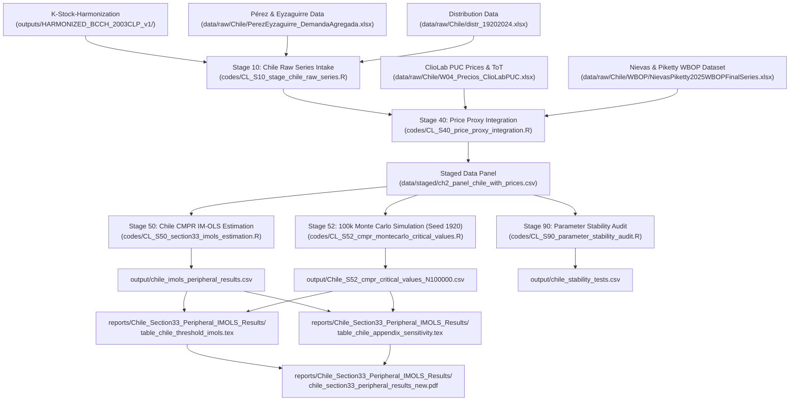

# Chile Master Data Provenance & Cross-Referenced Source-of-Truth Audit Report

**Date:** 2026-08-09  
**Scope:** Aggregate Chilean Economy (1920–2024, $T=104$) — Peripheral Threshold CMPR IM-OLS  
**Authority:** `chapter2_vault/06_paper_facing/00N_Chapter2_PaperFacing_MAP.md` & `00E_Chapter2_PaperFacing_Constitution.md`

---

## Executive Summary

This audit report establishes the complete end-to-end data provenance and cross-referenced source-of-truth mapping for the Chilean empirical pipeline (Section 3.3 / 4.4 of Chapter 2). It documents the precise variable lineage from the upstream provider repository (`K-Stock-Harmonization`), ClioLab PUC, Pérez & Eyzaguirre, functional distribution panels, and Nievas & Piketty (2025) World Balance of Payments (`WBOP`) dataset down through the processing scripts, econometric estimation engines, 100,000-pass seed-locked Monte Carlo simulation suite (`CL_S52`), LaTeX table generators, compiled PDF manuscripts, and vault notes.

---

## 1. Upstream Raw Source Providers & Ingredient Lineage

Due to Chilean national accounting constraints (lack of historical sector-level NFC financial accounts back to 1920), all estimations utilize aggregate Real GDP ($y_t = \ln Y_t$) and total capital stock components ($K^{\text{NR}}_t, K^{\text{ME}}_t$).

| Variable Symbol | Full Description | Primary Source Provider / Repo | Specific Table / Sheet Identifiers | Model Functional Role |
| :--- | :--- | :--- | :--- | :--- |
| $y_t$ | Log Aggregate Real GDP ($\ln Y_t$) | Pérez & Eyzaguirre (2016) / BCCh | `PerezEyzaguirre_DemandaAgregada.xlsx` | Dependent variable (Real Net Output) |
| $k^{\text{NR}}_t$ | Log Non-Residential Structures Stock | `K-Stock-Harmonization` | `harmonized_series_2003CLP_1900_2024.csv` | Base extensive capital envelope ($K^{\text{NR}}$) |
| $k^{\text{ME}}_t$ | Log Machinery & Equipment Stock | `K-Stock-Harmonization` | `harmonized_series_2003CLP_1900_2024.csv` | Base intensive mechanization stock ($K^{\text{ME}}$) |
| $I_{\text{ME}, t}$ | Gross Machinery Investment (2003 CLP) | Pérez & Eyzaguirre (`FBKF en maquinaria`) | `PerezEyzaguirre_DemandaAgregada.xlsx` | Physical machinery demand input |
| $\kappa_t$ | Mechanization Gap ($k^{\text{ME}}_t - k^{\text{NR}}_t$) | Derived in `CL_S10_stage_chile_raw_series.R` | Derived from harmonized stocks | Mechanization intensity regressor |
| $\omega_{t-1}$ | Lagged Distribution Wage Share | Functional Distribution Panel | `distr_19202024.xlsx` | Class struggle / distributive state mediator |
| $M^{\text{cap, ToT}}_t$ | Terms-of-Trade Purchasing Power of Exports | Pérez & Eyzaguirre + ClioLab `TERMINT` | Derived: $\text{ToT}_t \cdot X_{\text{FOB}, t}$ | Threshold variable (export capacity) |
| $\text{Imbalance}_t$ | Machinery Import Demand Imbalance Ratio | Derived in `CL_S40_price_proxy_integration.R` | Derived: $\ln(I_{\text{ME}, t}) - \ln(M^{\text{cap, ToT}}_t)$ | Demand/supply capital import threshold |
| $P_K$ | Gross Capital Formation Deflator (2003=100) | `K-Stock-Harmonization` | `harmonized_pk_2003base_1940_2024.csv` | Internal capital stock deflator |
| $\text{TCREAL}$ | Real Exchange Rate Index (2003=1.0) | ClioLab PUC | `W04_Precios_ClioLabPUC.xlsx` (Sheet 4.2.2) | Foreign price competitiveness proxy |
| $\text{IPMUSA}$ | US Wholesale Capital Price Index | ClioLab PUC | `W04_Precios_ClioLabPUC.xlsx` (Sheet 4.3.6) | Capital goods import price proxy |
| $\text{TERMINT}$ | Terms of Trade Index (2003=1.0) | ClioLab PUC | `W04_Precios_ClioLabPUC.xlsx` (Sheet 4.3.2) | Terms of trade index |
| $M^{\text{manuf}}_t / Y_t$ | Manufactured Goods Imports (% GDP) | Nievas & Piketty (2025) WBOP Sheet `B3c` | `NievasPiketty2025WBOPFinalSeries.xlsx` (Col `CL`) | Capital goods import dependence threshold |
| $D1c_t$ | Foreign Income Outflows (% GDP) | Nievas & Piketty (2025) WBOP Sheet `D1c` | `NievasPiketty2025WBOPFinalSeries.xlsx` (Col `CL`) | Profit remittance / debt drain threshold |
| $F1_t$ | Net Current Account Balance (% GDP) | Nievas & Piketty (2025) WBOP Sheet `F1` | `NievasPiketty2025WBOPFinalSeries.xlsx` (Col `CL`) | External balance threshold |
| $p^{\kappa}_t$ | Log Relative Price Deflator Proxy Matrix | Staged in `CL_S40_price_proxy_integration.R` | 4 variants ($p^{\kappa}_{\text{rer}}, p^{\kappa}_{\text{ipmusa}}, p^{\kappa}_{\text{composite}}, p^{\kappa}_{\text{tot\_adj}}$) | Relative price cost regressor |

---

## 2. Staged Architecture & Code Pipeline Contracts

---

## 3. Seed-Locked Monte Carlo Simulation & Non-Standard Critical Values

The 100,000-pass seed-locked Monte Carlo simulation (`CL_S52_cmpr_montecarlo_critical_values.R`, `set.seed(1920)`, `clusterSetRNGStream(cl, 1920)`) generated non-standard fixed-$b$ critical values for the threshold specifications:

| Metric / Test | 90% Bound (10% Sig) | 95% Bound (5% Sig) | 99% Bound (1% Sig) | Empirical Range | Significance Verdict |
| :--- | :--- | :--- | :--- | :--- | :--- |
| **Shin LM Cointegration ($C_{\text{Shin}}$)** | — | $0.0430$ | $0.0682$ | $0.02 - 0.04$ | **Cointegrated** ($H_0$ Accepted) |
| **ToT Capacity Trap Penalty ($t_{\delta_{\omega\kappa}}$)** | $2.585$ | **$3.697$** | $8.736$ | **$-6.52$** | **Significant at 5% Level ($^{**}$)** |
| **WBOP Income Outflow Penalty ($t_{\delta_{\omega\kappa}}$)** | **$2.585$** | $3.697$ | $8.736$ | **$-3.55$** | **Significant at 10% Level ($^{*}$)** |

---

## 4. Paper-Facing Vault & Manuscript Cross-Reference

1. **Main LaTeX Table**: `reports/Chile_Section33_Peripheral_IMOLS_Results/table_chile_threshold_imols.tex` (7 columns).
2. **Appendix Sensitivity Table**: `reports/Chile_Section33_Peripheral_IMOLS_Results/table_chile_appendix_sensitivity.tex`.
3. **Compiled PDF Report**: `reports/Chile_Section33_Peripheral_IMOLS_Results/chile_section33_peripheral_results_new.pdf` (5 pages).
4. **Data Provenance Management Note**: `chapter2_vault/04_data_measurement/V02_Chile_KStock_DataProvenance_Management.md`.
5. **Paper-Facing Model Draft**: `chapter2_vault/06_paper_facing/drafts/ch2_sec4_4_peripheral_extension_Chile/ch2_sec4_4_1_specifications.md`.

---

## Related Vault Notes & Governance Links

- [[00N_Chapter2_PaperFacing_MAP]] — Locked 6-section chapter structure
- [[00E_Chapter2_PaperFacing_Constitution]] — Constitutional paper-facing claim
- [[00S_Chapter2_Symbology_and_Notation_Lock]] — Master notation lock
- [[D03_capacity_utilization_level_anchor_pinch_year_protocol]] — Pinch-year level anchor protocol
- [[V02_Chile_KStock_DataProvenance_Management]] — Chile data provenance management note
- [[2026-08-07_data_provenance_audit_report]] — US master data provenance audit report
- [[ch2_sec4_4_1_specifications]] — Chile peripheral extension model specifications draft
